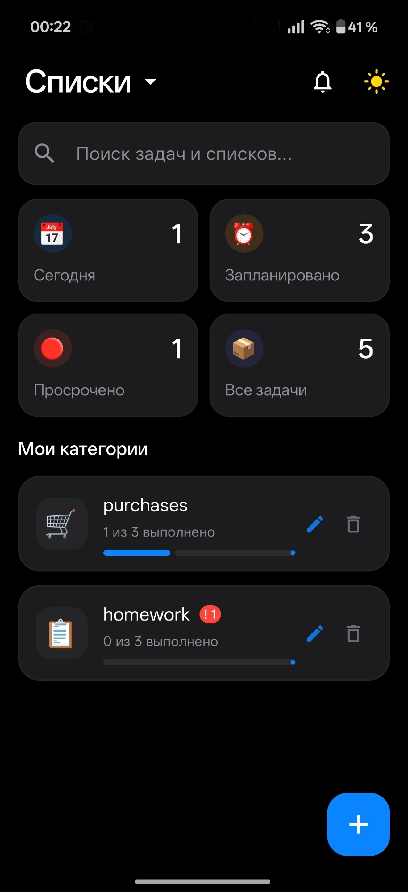
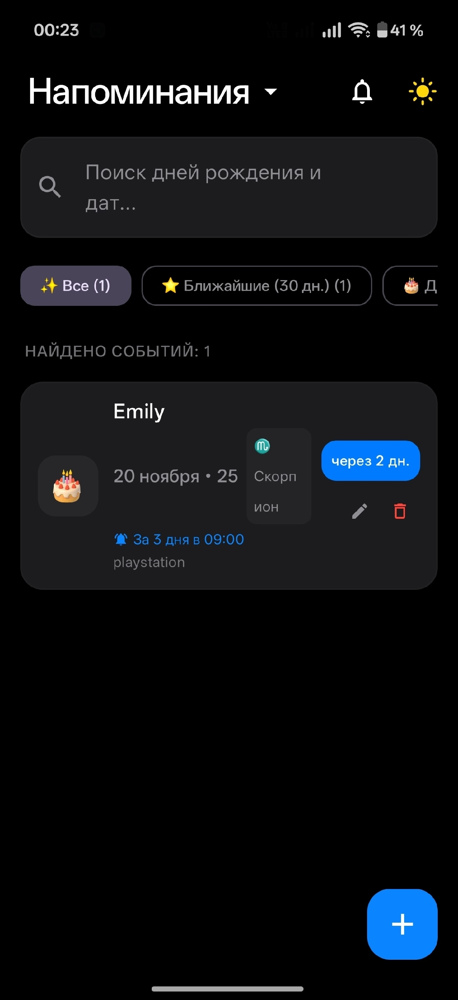
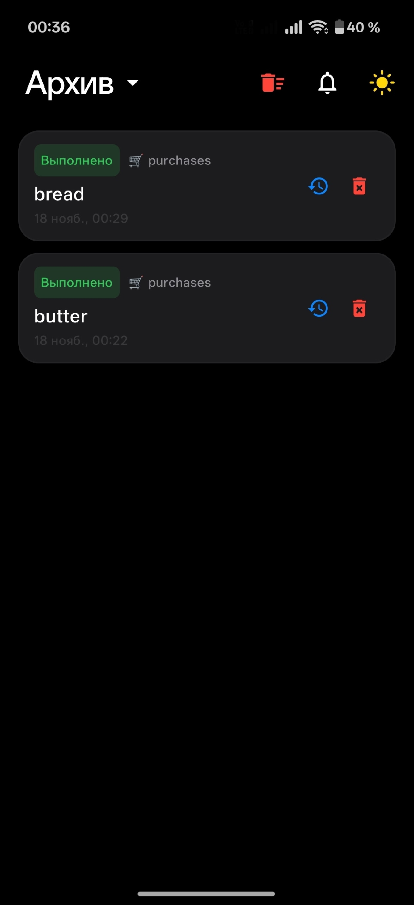

<div align="center">

# 📱 SmartDo
### Умные заметки, списки задач и памятные даты для Android

[](https://kotlinlang.org)
[](https://developer.android.com/jetpack/compose)
[](https://android.com)
[]()
[](LICENSE)

<br/>

**SmartDo** — это современное, быстрое и эстетичное Android-приложение для организации вашей повседневной жизни.  
Создано с акцентом на чистый дизайн в стиле iOS / Cupertino, плавные анимации, точные системные уведомления и абсолютную конфиденциальность данных.

<br/>

## 📸 Скриншоты интерфейса

| 📋 Списки и Задачи | 🎂 Напоминания и Зодиак | 🗄️ Архив и Темы |
|:---:|:---:|:---:|
|  |  |  |

</div>

---

## 📑 Содержание
1. [Скриншоты интерфейса](#-скриншоты-интерфейса)
2. [Особенности и возможности](#-особенности-и-возможности)
3. [Структура приложения](#-структура-приложения)
4. [Как установить на телефон (для пользователей)](#-как-установить-на-телефон-для-пользователей)
5. [Сборка из исходного кода (для разработчиков)](#-сборка-из-исходного-кода-для-разработчиков)
6. [Архитектура и стек технологий](#-архитектура-и-стек-технологий)
7. [Конфиденциальность и безопасность](#-конфиденциальность-и-безопасность)
8. [Лицензия](#-лицензия)

---

## ✨ Особенности и возможности

### 📋 1. Умные списки и категории задач
* **Кастомизация папок:** Создавайте собственные категории с выбором названия и выразительных иконок (Работа, Дом, Учёба, Спорт, Покупки и др.).
* **Редактирование в пару кликов:** Легко меняйте название задачи, срок выполнения, время напоминания или категорию в любой момент.
* **Смарт-фильтры:** Быстрый доступ к папкам «Сегодня», «Запланировано» и общему списку всех задач.
* **Свайпы и тактильный отклик:** Смахните задачу вправо для завершения или влево для удаления — с приятным физическим виброоткликом (Haptic Feedback).
* **Мгновенный поиск:** Быстрый фильтр заметок по первым введённым буквам.

### ⏰ 2. Точные напоминания и будильники (AlarmManager)
* **Работает всегда:** Напоминания приходят строго вовремя, даже если приложение закрыто, экран заблокирован или телефон находится в режиме энергосбережения Doze Mode.
* **Настраиваемое время:** Напоминание точно в дедлайн или заранее (за 5 минут, 15 минут, 30 минут, 1 час или за сутки).
* **Центр уведомлений:** Иконка колокольчика 🔔 на главном экране открывает историю всех пришедших уведомлений с возможностью очистки и счётчиком непрочитанных.

### 🎂 3. Памятные даты, Дни рождения и Знаки зодиака
* **Автоматический расчёт возраста:** Укажите год рождения человека, и приложение само посчитает, сколько лет ему исполняется.
* **Обратный отсчёт:** На карточке каждого события видно точное число дней, оставшихся до праздника.
* **♈ Знаки зодиака:** Приложение автоматически определяет знак зодиака по дню и месяцу рождения и отображает стильный бейдж (например, `[♉ Телец]`, `[♌ Лев]`, `[♐ Стрелец]`).
* **Поиск по созвездиям:** В строке поиска можно набрать «Овен» или «Скорпион», чтобы найти всех близких под этим знаком.
* **Apple Filter Chips:** Удобные плашки быстрой фильтрации:
  * `✨ Все` — полный список дат;
  * `⭐ Ближайшие (30 дн.)` — события текущего месяца;
  * `🎂 Дни рождения` — персональные праздники;
  * `💍 Годовщины` — важные даты отношений и свадеб;
  * `🎉 Праздники` — ежегодные праздничные дни.

### 🗄️ 4. Безопасный архив
* Выполненные или случайно удалённые задачи не стираются бесследно — они попадают в **Архив**.
* Любую задачу из архива можно вернуть обратно в один клик либо удалить безвозвратно.

### 🌓 5. Светлая и глубокая тёмная темы
* Полноценная поддержка дневного и тёмного ночного (AMOLED Black) интерфейсов.
* Переключение в одно касание и автоматическое сохранение выбранного режима.

---

## 🗺️ Структура приложения

Навигация между экранами устроена через элегантное выпадающее меню в шапке (`Списки ▼`, `Напоминания ▼`, `Архив ▼`, `Статистика ▼`), где текущий экран автоматически скрыт из списка выбора:

```
SmartDo
├── 📋 Списки (Категории, Смарт-папки, Задачи и поиск)
├── 🎂 Напоминания (Дни рождения, знаки зодиака, обратный отсчет, фильтры)
├── 🗄️ Архив (История выполненных и удаленных дел с восстановлением)
├── 📊 Статистика (Прогресс по задачам и подзадачам)
├── 🔔 Центр уведомлений (Лог всех пришедших напоминаний)
└── ⚙️ Настройки (Параметры приложения)
    ├── ℹ️ О приложении (Информация о версии и возможностях)
    ├── 🔄 Перенос данных (Импорт и экспорт заметок)
    └── 🎨 Изменить тему (Оформление приложения)
```

---

## 📲 Как установить на телефон (для пользователей)

Если вы хотите просто установить готовое приложение на свой смартфон:

1. Соберите или скачайте файл **`SmartDo.apk`** (или `app-debug.apk`).
2. Отправьте файл себе на телефон (через Telegram в «Избранное», через WhatsApp или по USB-кабелю).
3. На телефоне нажмите на скачанный APK-файл.
4. При появлении запроса подтвердите: **«Разрешить установку из этого источника»**.
5. Нажмите **«Установить»** — и ярлык **SmartDo** появится на рабочем столе вашего телефона!

---

## 💻 Сборка из исходного кода (для разработчиков)

### Требования:
* **Android Studio:** Ladybug (2024.2+) / Hedgehog или новее.
* **JDK:** Java 17 или Java 21.
* **Android SDK:** Минимальная версия `Android 8.0 (API 26)`, целевая `Android 15 / 16 (API 35+)`.

### Пошаговая инструкция:

1. **Клонируйте репозиторий:**
   ```bash
   git clone https://github.com/LostErr0r/SmartDo.git
   cd SmartDo
   ```

2. **Откройте проект в Android Studio:**
   * Выберите `File` ➔ `Open...` ➔ выберите папку проекта.
   * Дождитесь завершения автоматической синхронизации Gradle (Gradle Sync).

3. **Сборка APK-файла:**
   * **Через меню:** `Build` ➔ `Build Bundle(s) / APK(s)` ➔ `Build APK(s)`.
   * **Или через терминал:**
     ```bash
     # Для Windows:
     gradlew assembleDebug

     # Для macOS / Linux:
     ./gradlew assembleDebug
     ```
   Готовый файл появится по пути:  
   `app/build/outputs/apk/debug/app-debug.apk`.

4. **Запуск на устройстве:**
   * Подключите телефон по USB с включённой «Отладкой по USB» или запустите эмулятор.
   * Нажмите зелёную кнопку **Run ▶** (Shift + F10).

---

## 🏗️ Архитектура и стек технологий

| Компонент | Используемая технология | Назначение |
|---|---|---|
| **Язык** | Kotlin 2.0+ | Надежный, современный и безопасный код |
| **UI** | Jetpack Compose + Material 3 | Декларативный интерфейс в дизайне Cupertino / iOS |
| **Архитектура** | MVVM + Clean Architecture | Четкое разделение данных, логики и отображения |
| **State Management** | StateFlow, SharedFlow, Coroutines | Реактивные асинхронные потоки данных |
| **Хранилище данных** | Jetpack DataStore (Preferences) | Легковесное и надежное локальное хранилище |
| **Сериализация** | Kotlinx Serialization | Быстрое и безопасное преобразование JSON |
| **Системные будильники** | Android AlarmManager | Гарантированное срабатывание напоминаний по таймеру |
| **Уведомления** | NotificationManagerCompat | Каналы уведомлений с поддержкой Android 13+ (POST_NOTIFICATIONS) |

---

## 🔒 Конфиденциальность и безопасность

* **Без интернета:** Приложение не запрашивает доступ в сеть интернет (`android.permission.INTERNET` отсутствует в манифесте).
* **Локальное хранение:** Ваши заметки, списки покупок и дни рождения близких людей хранятся исключительно в защищенном хранилище вашего телефона и никогда никуда не отправляются.
* **Без рекламы и трекеров:** Полное отсутствие рекламных SDK и систем скрытой аналитики.

---

## 📄 Лицензия

Проект распространяется под открытой лицензией **MIT License**.  
Вы можете свободно использовать, модифицировать и развивать его под свои задачи.
